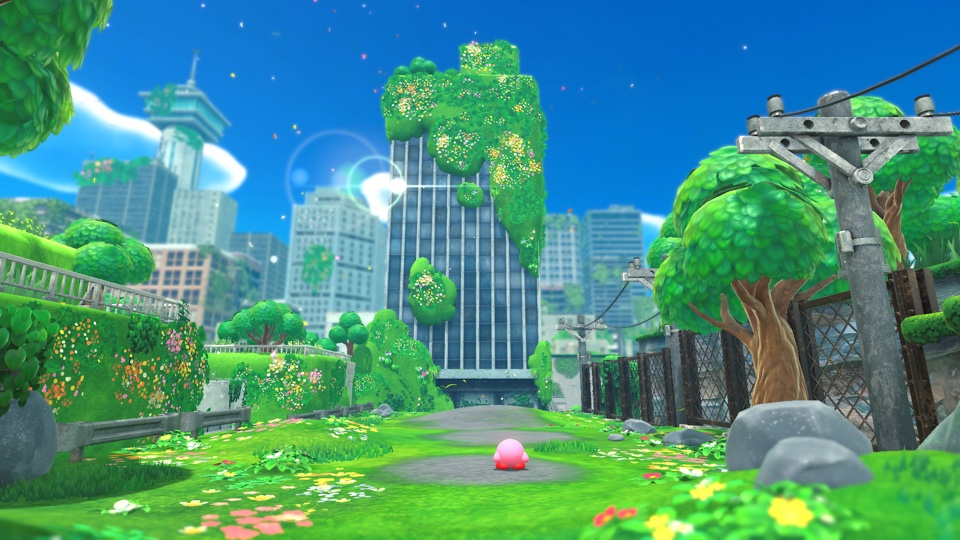
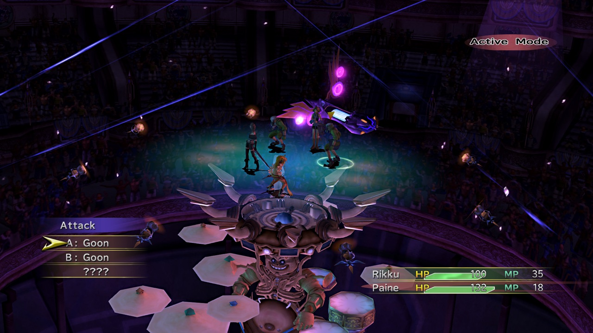
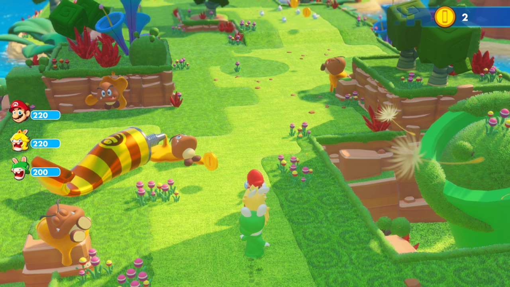

# nxnative

Play your own Nintendo Switch games natively on iPhone and iPad. Bring your game (its NSP files) and your `prod.keys`; one script turns them into an IPA that you sideload.

It is not an emulator: the game's own code runs directly on the Apple chip, with Switch graphics rebuilt on Metal. Nothing from any game is in this repository, and the project is not affiliated with Nintendo or any game publisher.

## How to play

### With a Mac app

Community projects build on nxnative with Mac apps that turn your games into apps for your iPhone, iPad or Mac, with no command line, and keep them in a library. They are separate projects: questions and bugs about them go to their own pages.

- [NX2Apple](https://github.com/LNPANDY/NX2Apple)
- [NX Play](https://github.com/varyform/nx-native-wrapper)
- [NxNative Launcher](https://github.com/rennan101/nxnative_Launcher)

### Build from the command line

You need a Mac with macOS 26.6 or later, [Xcode](https://apps.apple.com/app/xcode/id497799835) 27.1, [Homebrew](https://brew.sh) and Python 3.12 or newer.

**1. Install the tools** (only once), in Terminal:

```
xcodebuild -downloadComponent MetalToolchain
git clone https://github.com/seedds/nxnative.git && cd nxnative
brew install xcodegen zstd glslang
brew install --cask dotnet-sdk
python3 -m pip install lz4 capstone fonttools nsz "backports.zstd; python_version < '3.14'"
```

**2. Put your game in a folder**: the game, plus its update and DLC if you have them (`.nsp`, `.xci`, `.nsz` or `.xcz`):

```
~/Games/MarioWonder/
  Super Mario Bros. Wonder [010015100B514000][v0].nsp
  Super Mario Bros. Wonder [010015100B514800][v327680].nsp
```

**3. Build**, with your game folder and your `prod.keys`:

```
python3 scripts/build_ipa_from_nsp.py ~/Games/MarioWonder -k ~/keys/prod.keys
```

The IPA appears in the game's folder. The first build takes 30–60 minutes and needs free disk space of about twice the game's size plus 10 GB; building again is much faster.

To play on the Mac instead, add `--platform mac-app`: you get a Mac app of the game to open from Finder. All options: [The packing script in detail](docs/development.md#the-packing-script-in-detail).

### Install

Install the IPA on your iPhone or iPad with a sideloading tool such as AltStore, Sideloadly or LiveContainer. If your tool offers **Increased Memory Limit**, turn it on: the bigger games need it.

Game too big to install? Build again with `--romfs separate`, and run the command the script prints once to copy the game files to your phone ([Quick reinstalls](docs/development.md#quick-reinstalls)).

Controls, saves and settings: [Playing](docs/playing.md).

## Games

Games tested on Mac or iPhone. See the [per-game notes](dm/games/README.md#games) for tested platforms, progress and known issues:

Needs iOS / iPadOS 26 or later on an iPhone 15 Pro or newer (A17 Pro chip or later) or an iPad with an M1 chip or later: the games' textures are BC-compressed, and older iPhones can't read that format. Other games aren't supported yet. For them the script writes a survey and still tries its best to pack an IPA, guessing the game's settings; such an IPA may not start.

Under each game: the IPA's size, and "60 fps with 1.2.0" where the game runs at 60 fps (30 on the Switch) with that update.

<!-- gallery: written by dm/tools/docs_gallery.py from docs/images/gallery.tsv; change the table, then run it -->
<table>
<tr>
<td align="center" valign="top" width="33%"><br><sub><b>Mario Kart 8 Deluxe</b><br>~11.9 GB · no Mii heads</sub></td>
<td align="center" valign="top" width="33%"><br><sub><b>Mario vs. Donkey Kong</b><br>~1.6 GB</sub></td>
<td align="center" valign="top" width="33%"><br><sub><b>Paper Mario: The Thousand-Year Door</b><br>~5 GB · 60 fps with 1.0.1</sub></td>
</tr>
<tr>
<td align="center" valign="top" width="33%"><br><sub><b>Super Mario 3D World + Bowser's Fury</b><br>~3 GB</sub></td>
<td align="center" valign="top" width="33%"><br><sub><b>Super Mario Bros. Wonder</b><br>~4 GB</sub></td>
<td align="center" valign="top" width="33%"><br><sub><b>Super Mario Galaxy</b><br>~3 GB</sub></td>
</tr>
<tr>
<td align="center" valign="top" width="33%"><br><sub><b>Super Mario Galaxy 2</b><br>~3 GB</sub></td>
<td align="center" valign="top" width="33%"><br><sub><b>Super Mario Odyssey</b><br>~6 GB</sub></td>
<td align="center" valign="top" width="33%"><br><sub><b>The Legend of Zelda: Breath of the Wild</b><br>~16 GB · 60 fps with 1.9.0</sub></td>
</tr>
<tr>
<td align="center" valign="top" width="33%"><br><sub><b>The Legend of Zelda: Link's Awakening</b><br>~6 GB</sub></td>
<td align="center" valign="top" width="33%"><br><sub><b>The Legend of Zelda: Tears of the Kingdom</b><br>~17 GB · 60 fps with 1.4.3</sub></td>
<td align="center" valign="top" width="33%"><br><sub><b>13 Sentinels: Aegis Rim</b><br>~5 GB</sub></td>
</tr>
<tr>
<td align="center" valign="top" width="33%"><br><sub><b>Absolum</b><br>~2 GB</sub></td>
<td align="center" valign="top" width="33%"><br><sub><b>Ace Attorney Investigations Collection</b><br>~7 GB</sub></td>
<td align="center" valign="top" width="33%"><br><sub><b>Advance Wars 1+2: Re-Boot Camp</b><br>~7.1 GB</sub></td>
</tr>
<tr>
<td align="center" valign="top" width="33%"><br><sub><b>AI: THE SOMNIUM FILES</b><br>~8.3 GB</sub></td>
<td align="center" valign="top" width="33%"><br><sub><b>AI: THE SOMNIUM FILES - nirvanA Initiative</b><br>~11.6 GB</sub></td>
<td align="center" valign="top" width="33%"><br><sub><b>Animal Crossing: New Horizons</b><br>~10.5 GB</sub></td>
</tr>
<tr>
<td align="center" valign="top" width="33%"><br><sub><b>ANIMAL WELL</b><br>~54 MB</sub></td>
<td align="center" valign="top" width="33%"><br><sub><b><a href="dm/games/01007300020FA000/README.md">ASTRAL CHAIN</a></b><br>~9.7 GB · 60 fps target with 1.0.1</sub></td>
<td align="center" valign="top" width="33%"><br><sub><b>Balatro</b><br>~82 MB · played by touch</sub></td>
</tr>
<tr>
<td align="center" valign="top" width="33%"><br><sub><b>BALL x PIT</b><br>~1.1 GB</sub></td>
<td align="center" valign="top" width="33%"><br><sub><b>Bayonetta</b><br>~8.8 GB</sub></td>
<td align="center" valign="top" width="33%"><br><sub><b>Bayonetta 2</b><br>~12.5 GB</sub></td>
</tr>
<tr>
<td align="center" valign="top" width="33%"><br><sub><b>Bayonetta 3</b><br>~14.2 GB</sub></td>
<td align="center" valign="top" width="33%"><br><sub><b>Big Brain Academy: Brain vs. Brain</b><br>~0.8 GB</sub></td>
<td align="center" valign="top" width="33%"><br><sub><b>Brain Memory Training Academy</b><br>~0.1 GB</sub></td>
</tr>
<tr>
<td align="center" valign="top" width="33%"><br><sub><b>Captain Toad: Treasure Tracker</b><br>~2 GB</sub></td>
<td align="center" valign="top" width="33%"><br><sub><b>Catherine: Full Body</b><br>~14 GB</sub></td>
<td align="center" valign="top" width="33%"><br><sub><b>Celeste</b><br>~0.9 GB</sub></td>
</tr>
<tr>
<td align="center" valign="top" width="33%"><br><sub><b>Cuphead</b><br>~5 GB</sub></td>
<td align="center" valign="top" width="33%"><br><sub><b>DARK SOULS: REMASTERED</b><br>~4 GB · 60 fps with 1.0.3</sub></td>
<td align="center" valign="top" width="33%"><br><sub><b>Digimon Story Cyber Sleuth: Complete Edition</b><br>~5 GB</sub></td>
</tr>
<tr>
<td align="center" valign="top" width="33%"><br><sub><b>Donkey Kong Country: Tropical Freeze</b><br>~7.3 GB</sub></td>
<td align="center" valign="top" width="33%"><br><sub><b>DRAGON QUEST VII Reimagined</b><br>~5.9 GB</sub></td>
<td align="center" valign="top" width="33%"><br><sub><b>DRAGON QUEST XI S: Echoes of an Elusive Age – Definitive Edition</b><br>~15 GB · 60 fps with 1.0.4</sub></td>
</tr>
<tr>
<td align="center" valign="top" width="33%"><br><sub><b>FINAL FANTASY RESONANCE</b><br>~10 GB · 60 fps with 1.0.1</sub></td>
<td align="center" valign="top" width="33%"><br><sub><b>FINAL FANTASY TACTICS - The Ivalice Chronicles</b><br>~11 GB</sub></td>
<td align="center" valign="top" width="33%"><br><sub><b>Fire Emblem Engage</b><br>~15 GB · 60 fps with 2.0.0</sub></td>
</tr>
<tr>
<td align="center" valign="top" width="33%"><br><sub><b>Fire Emblem: Three Houses</b><br>~13 GB · 60 fps with 1.2.0</sub></td>
<td align="center" valign="top" width="33%"><br><sub><b>Ghost Trick: Phantom Detective</b><br>~3 GB</sub></td>
<td align="center" valign="top" width="33%"><br><sub><b>The Great Ace Attorney Chronicles</b><br>~4 GB</sub></td>
</tr>
<tr>
<td align="center" valign="top" width="33%"><br><sub><b>Hades</b><br>~4 GB</sub></td>
<td align="center" valign="top" width="33%"><br><sub><b>Hades II</b><br>~4 GB</sub></td>
<td align="center" valign="top" width="33%"><br><sub><b>Hollow Knight: Silksong</b><br>~6.4 GB</sub></td>
</tr>
<tr>
<td align="center" valign="top" width="33%"><br><sub><b>Hyrule Warriors: Age of Calamity</b><br>~15 GB · 60 fps with 1.3.0</sub></td>
<td align="center" valign="top" width="33%"><br><sub><b>Kirby and the Forgotten Land</b><br>~6.4 GB</sub></td>
<td align="center" valign="top" width="33%"><br><sub><b>Luigi's Mansion 3</b><br>~7.5 GB · 60 fps with 1.4.0</sub></td>
</tr>
<tr>
<td align="center" valign="top" width="33%"><br><sub><b>Metroid Dread</b><br>~5 GB</sub></td>
<td align="center" valign="top" width="33%"><br><sub><b>Monster Hunter Rise</b><br>~22 GB · 60 fps with 16.0.2</sub></td>
<td align="center" valign="top" width="33%"><br><sub><b>Monster Train 2</b><br>~1.6 GB · 60 fps with 1.1.1</sub></td>
</tr>
<tr>
<td align="center" valign="top" width="33%"><br><sub><b>OCTOPATH TRAVELER</b><br>~3.6 GB</sub></td>
<td align="center" valign="top" width="33%"><br><sub><b>Octopath Traveler 0</b><br>~4 GB · 60 fps with 1.0.5</sub></td>
<td align="center" valign="top" width="33%"><br><sub><b>Octopath Traveler II</b><br>~5.9 GB · 60 fps with 1.1.1</sub></td>
</tr>
<tr>
<td align="center" valign="top" width="33%"><br><sub><b>Patrick's Parabox</b><br>~0.2 GB</sub></td>
<td align="center" valign="top" width="33%"><br><sub><b>Persona 5 Royal</b><br>~14.9 GB</sub></td>
<td align="center" valign="top" width="33%"><br><sub><b>Pikmin 4</b><br>~10.8 GB</sub></td>
</tr>
<tr>
<td align="center" valign="top" width="33%"><br><sub><b>Pokémon Brilliant Diamond</b><br>~4.6 GB · 60 fps with 1.3.0</sub></td>
<td align="center" valign="top" width="33%"><br><sub><b>Pokémon Legends: Z-A</b><br>~6 GB</sub></td>
<td align="center" valign="top" width="33%"><br><sub><b>Pokémon Scarlet</b><br>~7.0 GB</sub></td>
</tr>
<tr>
<td align="center" valign="top" width="33%"><br><sub><b>Pokémon Sword</b><br>~12.4 GB</sub></td>
<td align="center" valign="top" width="33%"><br><sub><b>Pokémon Shield</b><br>~12.4 GB</sub></td>
<td align="center" valign="top" width="33%"><br><sub><b>Portal</b><br>~2.6 GB</sub></td>
</tr>
<tr>
<td align="center" valign="top" width="33%"><br><sub><b>Raging Loop</b><br>~0.9 GB</sub></td>
<td align="center" valign="top" width="33%"><br><sub><b>Rhythm Heaven Groove</b><br>~3 GB</sub></td>
<td align="center" valign="top" width="33%"><br><sub><b>ROMANCE OF THE THREE KINGDOMS 8 REMAKE</b><br>~16.8 GB · controller only</sub></td>
</tr>
<tr>
<td align="center" valign="top" width="33%"><br><sub><b>Sea of Stars</b><br>~5.1 GB</sub></td>
<td align="center" valign="top" width="33%"><br><sub><b>SHIN MEGAMI TENSEI V: Vengeance</b><br>~14.6 GB · 60 fps with 1.0.3</sub></td>
<td align="center" valign="top" width="33%"><br><sub><b>Stardew Valley</b><br>~0.6 GB</sub></td>
</tr>
<tr>
<td align="center" valign="top" width="33%"><br><sub><b>STEINS;GATE RE:BOOT</b><br>~6 GB</sub></td>
<td align="center" valign="top" width="33%"><br><sub><b>Super Smash Bros. Ultimate</b><br>~17.5 GB · offline</sub></td>
<td align="center" valign="top" width="33%"><br><sub><b>Taiko Risshiden V DX</b><br>~3.3 GB · Japanese · played by touch</sub></td>
</tr>
<tr>
<td align="center" valign="top" width="33%"><br><sub><b>Unicorn Overlord</b><br>~4 GB</sub></td>
<td align="center" valign="top" width="33%"><br><sub><b><a href="dm/games/01006000040C2000/README.md">Yoshi's Crafted World</a></b><br>~6.1 GB</sub></td>
<td align="center" valign="top" width="33%"><br><sub><b>NieR:Automata The End of YoRHa Edition</b><br>~10.9 GB · 60 fps with 1.0.3</sub></td>
</tr>
<tr>
<td align="center" valign="top" width="33%"><br><sub><b>The Legend of Zelda: Echoes of Wisdom</b><br>~7.8 GB</sub></td>
<td align="center" valign="top" width="33%"><br><sub><b>Donkey Kong Country Returns HD</b><br>~11.6 GB</sub></td>
<td align="center" valign="top" width="33%"><br><sub><b>Mario + Rabbids Sparks of Hope</b><br>~9.8 GB</sub></td>
</tr>
<tr>
<td align="center" valign="top" width="33%"><br><sub><b>Xenoblade Chronicles 2</b><br>~17.1 GB</sub></td>
<td align="center" valign="top" width="33%"><br><sub><b>Xenoblade Chronicles 3</b><br>~19.2 GB</sub></td>
<td align="center" valign="top" width="33%"><br><sub><b>FINAL FANTASY CRYSTAL CHRONICLES Remastered Edition</b></sub></td>
</tr>
<tr>
<td align="center" valign="top" width="33%"><br><sub><b><a href="dm/games/010032E00E6E2000/README.md">Return of the Obra Dinn</a></b><br>~0.9 GB</sub></td>
<td align="center" valign="top" width="33%"><br><sub><b><a href="dm/games/010040801A4C8000/README.md">Blasphemous 2</a></b><br>~1.5 GB</sub></td>
<td align="center" valign="top" width="33%"><br><sub><b><a href="dm/games/0100D5B026844000/README.md">Silver Pines</a></b></sub></td>
</tr>
<tr>
<td align="center" valign="top" width="33%"><br><sub><b><a href="dm/games/0100698009C6E000/README.md">Blasphemous</a></b><br>~0.9 GB</sub></td>
<td align="center" valign="top" width="33%"><br><sub><b><a href="dm/games/0100BC300CB48000/README.md">FINAL FANTASY X/X-2 HD Remaster</a></b><br>~26.5 GB</sub></td>
<td align="center" valign="top" width="33%"><br><sub><b><a href="dm/games/010067300059A000/README.md">Mario + Rabbids Kingdom Battle</a></b><br>~5 GB</sub></td>
</tr>
</table>
<!-- end of gallery -->

## Pack an IPA

Prefer a graphical interface to the command line? **[NX2Apple](https://github.com/LNPANDY/NX2Apple)** is a community fork with a macOS app that runs this whole pipeline for you and packs the game files into a sharded RomFS archive for a slimmer IPA. It is a separate project that follows this one; the steps below are nxnative's own command-line way.

**1. Get nxnative and its tools** (once, on a Mac with [Xcode](https://apps.apple.com/app/xcode/id497799835) and [Homebrew](https://brew.sh)):

```
git clone https://github.com/seedds/nxnative.git && cd nxnative
brew bundle
python3 -m pip install -r requirements.txt
```

**2. Put one game's NSPs in a folder**: the base game (an NSP, or an XCI cartridge dump), plus its update and DLC if you have them:

```
~/Games/MarioWonder/
  Super Mario Bros. Wonder [010015100B514000][v0].nsp
  Super Mario Bros. Wonder [010015100B514800][v327680].nsp
```

NSZ and XCZ files (compressed NSPs and XCIs) work too: the script converts them once with [nsz](https://github.com/nicoboss/nsz) (`python3 -m pip install nsz`) and keeps the NSPs in `<title ID>_build/nsp/`, which takes their full size on disk.

Any version works, with or without an update: the script packs the newest version in the folder. DLC is optional too: the DLC in the folder is packed, and without it the game sees none, as on a Switch without it. Each game was tested on one version (an update named in the table above is the one its 60 fps needs). With another version the script builds the game with that version's own shaders and says that the version was not tested; fixes made for the tested version's code, such as the 60 fps ones, don't apply to it.

**3. Run the script:**

```
python3 scripts/build_ipa_from_nsp.py ~/Games/MarioWonder -k ~/keys/prod.keys
```

The IPA appears in the same folder (here `~/Games/MarioWonder/SMBWMobile.ipa`). The first build takes 30–60 minutes. A later one reuses every step whose inputs did not change, so after a pull that changes only the host it takes about a minute. The small `.idx` file beside the IPA (`.app.key` beside a Mac app) records what was packed; keep it for the next build. You need free disk space of about twice the NSPs' size plus 10 GB. Options such as `-o` (output path) and `--app-name` are listed by `-h`.

**4. Install** the IPA with your sideloading tool (AltStore, Sideloadly, LiveContainer, …). The app gets the game's name, icon and version (the update's version, for example 1.2.1 for Mario Wonder; the base game's when there is no update). Sign it with the **Increased Memory Limit** capability (`com.apple.developer.kernel.increased-memory-limit`) if your tool can: without it iOS gives the app about 3.4 GB and closes the bigger games (Hyrule Warriors: Age of Calamity and Hades II use more, Breath of the Wild and Cuphead come close); with it a recent iPhone gives about 6 GB.

To play on a Mac with Apple silicon instead, `--platform mac-app` packs a Mac app of the game that you open from Finder ([A Mac app](docs/development.md#a-mac-app)).

With an Apple developer account you can instead build and install from Xcode: `--prepare-xcode` makes an Xcode project for the game rather than an IPA ([Build and run on a device with Xcode](docs/development.md#build-and-run-on-a-device-with-xcode)).

## Play

**Settings.** A screen before the game starts offers what the game supports: frame rate, render scale, docked or handheld mode, game language, the frame-rate counter and rumble. Everything is on one scrollable screen, grouped into **Game**, **Controls** and **Performance**, with menus, sliders and a reset to the settings the game was tested with. Tap **Play** to start; the app remembers your choices. What each setting does: [Settings](docs/settings.md).

**Touch controls.** Tap **2D** / **3D** at the top to switch layouts; the app remembers your choice. Wonder, Engage, Dread, 13 Sentinels, Link's Awakening, Ace Attorney Investigations Collection, Unicorn Overlord, Rhythm Heaven Groove, Octopath Traveler 0, Pokémon Legends: Z-A, Cuphead, Absolum, Brain Memory Training Academy, The Great Ace Attorney Chronicles, STEINS;GATE RE:BOOT, Big Brain Academy: Brain vs. Brain, Patrick's Parabox, Celeste, Raging Loop and Mario vs. Donkey Kong start in 2D, the other games in 3D (STEINS;GATE RE:BOOT's quick save is R3, in the 3D layout). In 3D, the right stick (the camera in most games) is not drawn: swipe on the right third of the screen, starting anywhere off the buttons. In Super Mario Galaxy and Super Mario Galaxy 2, other touches outside the controls move the pointer; in Captain Toad: Treasure Tracker they touch the game's screen (touch blocks, stun enemies), and in Big Brain Academy: Brain vs. Brain too (its menus and activities).
A connected game controller hides the touch controls and keeps every button.

**Rumble.** Game vibration uses the iPhone's haptic engine or a compatible connected controller. Controllers with separate left/right haptic outputs keep those effects separate. The launcher's **Game rumble** and **Rumble strength** settings control it independently of **Touch feedback**. Phone rumble approximates the Switch's effects; physical feel and controller compatibility still need device testing.

**Shaking.** Shake the iPhone to shake the controller, in games that read its motion: Super Mario Odyssey's motion moves (such as the cap throw on a shake) need it, and Odyssey only takes them in its default docked mode. A light bump does not count; a sharp flick of the phone does.

- **Game language** is English by default. Pick another when packing with `--language` (`-l`), by code or by name: `-l ja`, `-l zh-Hans`, `-l French` (`LANGUAGE` in Spyder). It must be one the game has; the script prints the game's languages and stops on one it lacks. To change it without rebuilding, pick another on the settings screen.
- **Saves and logs** are in the Files app, under the app's name: `save/` and `log.txt`. When something goes wrong, send `log.txt` (the previous run is `log.prev.txt`).
- **Short stutters** the first time a new scene appears are normal: the app compiles graphics for it once and remembers them for the next launch. What it remembered, and what the game's list names, is built before the game starts, behind "Preparing shaders" and a progress bar when that takes more than half a second.
- **Reinstalling:** some sideloading tools give a reinstalled app a new data folder. Copy `save/` and `pso_user.tsv` over from the old one to keep your progress.
- **Settings in a file:** lines like `DM_OPMODE=0` (handheld mode: lower resolution, higher frame rate) in `Documents/env.txt` win over the settings screen, which then shows them greyed out. `DM_FPS_TARGET=30` keeps Breath of the Wild, Tears of the Kingdom, Octopath Traveler 0 and Octopath Traveler II at their original 30 fps, which saves battery; `DM_PRESENT_INTERVAL=game` does the same for Monster Train 2. `DM_SHOW_FPS=1` shows the frame rate at the top left (`--show-fps` when packing turns it on from the start). `DM_LAUNCHER=0` skips the settings screen.

## Known issues

<sub>[How it works](docs/development.md) · [Game notes](dm/games/README.md#games) · [Bring-up and debugging](docs/agents/README.md) · [Front ends](docs/frontends.md) · [Contributing](CONTRIBUTING.md)</sub>

### Acknowledgements

<sub>nxnative started from **[d2r-mobile](https://github.com/jhaizhou-ops/d2r-mobile)** (MIT), which developed this native-execution approach for Diablo II: Resurrected: its NSO rewriter, Horizon host, NVN-on-Metal layer and iOS app shell. Fixes go both ways. It also builds on **Ryujinx** (MIT; its shader translator, in `dm/third_party/ryujinx` with [a few fixes](dm/third_party/ryujinx/README.md), and a reference for system services), **[Atmosphère](https://github.com/Atmosphere-NX/Atmosphere)** (Horizon's synchronization semantics), **yuzu** (Maxwell encodings, kernel cross-checks), **[LibHac](https://github.com/Thealexbarney/LibHac)** and **hactool** (reading NSPs), **[SPIRV-Cross](https://github.com/KhronosGroup/SPIRV-Cross)** and **[glslang](https://github.com/KhronosGroup/glslang)** (shaders to Metal), **deko3d** (zlib; texture layout sizes), **libvpx**, **stb_vorbis**, the **Vulkan headers** and **NVIDIA FLIP** ([licenses](dm/third_party/README.md)), and **Capstone**, **lz4**, **fontTools** and **XcodeGen** in the build.</sub>

### License

<sub>MIT ([LICENSE](LICENSE)). Third-party code keeps its own license ([dm/third_party](dm/third_party/README.md)).</sub>
